# Re-Route Architecture

현재 프론트엔드와 백엔드 코드 기준 구조입니다.

# Frontend

## 1. 프로젝트 디렉터리

```mermaid
flowchart TB
    ROOT["frontend/"]

    ROOT --> CONFIG["설정 파일"]
    CONFIG --> PACKAGE["package.json"]
    CONFIG --> VITE["vite.config.js"]
    CONFIG --> HTML["index.html"]

    ROOT --> PUBLIC["public/"]
    PUBLIC --> FAVICON["favicon.svg"]

    ROOT --> SRC["src/"]
    SRC --> ENTRY["main.jsx"]
    SRC --> APP["App.jsx"]
    SRC --> API["api/"]
    SRC --> COMPONENTS["components/"]
    SRC --> CONTEXT["context/"]
    SRC --> HOOKS["hooks/"]
    SRC --> PAGES["pages/"]
    SRC --> ROUTES["routes/"]
    SRC --> DATA["data/"]
    SRC --> STYLES["styles/"]
    SRC --> UTILS["utils/"]

    API --> AXIOS["axiosInstance.js"]
    API --> AUTH_API["authApi.js"]
    API --> USER_API["userApi.js"]
    API --> COUNSELING_API["counselingApi.js"]
    API --> ACTION_API["actionItemApi.js"]
    API --> QUEST_API["questApi.js"]
    API --> COMMUNITY_API["communityApi.js"]
    API --> REHEARSAL_API["rehearsalApi.js"]
    API --> ADMIN_API["adminApi.js"]

    COMPONENTS --> COMMON["common/<br/>Button · Badge · Modal"]
    COMPONENTS --> LAYOUT["layout/<br/>Navbar · AppNavbar · Footer · AppLayout"]

    CONTEXT --> AUTH_CONTEXT["AuthContext.jsx"]

    HOOKS --> USE_AUTH["useAuth.js"]
    HOOKS --> USE_COUNSELING["useCounseling.js"]
    HOOKS --> USE_EMAIL["useEmailVerification.js"]
    HOOKS --> USE_MY_PAGE["useMyPage.js"]

    ROUTES --> PRIVATE_ROUTE["PrivateRoute.jsx"]
    ROUTES --> ADMIN_ROUTE["AdminRoute.jsx"]

    DATA --> MOCK_ISLAND["mockIsland.js"]
    DATA --> MOCK_COMMUNITY["mockCommunity.js"]
    DATA --> MOCK_USER["mockUser.js"]
    DATA --> MOCK_COUNSELING["mockCounseling.js"]
    DATA --> MOCK_QUESTS["mockQuests.js"]

    STYLES --> GLOBAL_CSS["global.css"]
    STYLES --> INDEX_CSS["index.css"]
    UTILS --> FORMAT["format.js"]

    PAGES --> PUBLIC_PAGES["공개 페이지<br/>Landing · Login · Register"]
    PAGES --> MEMBER_PAGES["회원 페이지<br/>Dashboard · Onboarding · Counseling<br/>AnalysisDetail · ActionItems · ActionItemDetail<br/>QuestDetail · QuestComplete · GoldenCards<br/>Rehearsal · Community · PostDetail · PostWrite · MyPage"]
    PAGES --> ADMIN_PAGE["관리자 페이지<br/>Admin"]
```

## 2. 애플리케이션 계층과 데이터 흐름

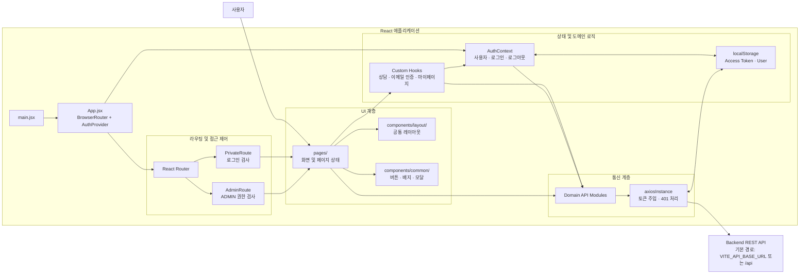

## 3. API 모듈 구성

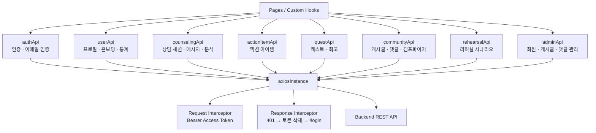

## 4. 라우팅 구조

```mermaid
flowchart TB
    START["URL 진입"] --> AUTH_CHECK{"로그인 상태"}

    AUTH_CHECK -->|비로그인| PUBLIC["공개 라우트"]
    AUTH_CHECK -->|로그인| PRIVATE["PrivateRoute"]

    PUBLIC --> LANDING["/ · Landing"]
    PUBLIC --> LOGIN["/login · Login"]
    PUBLIC --> REGISTER["/register · Register"]

    PRIVATE --> DASHBOARD["/dashboard · Dashboard"]
    PRIVATE --> ONBOARDING["/onboarding · Onboarding"]
    PRIVATE --> COUNSELING["/counseling · Counseling"]
    PRIVATE --> COUNSELING_TYPE["/counseling/type · CounselingType"]
    PRIVATE --> ANALYSIS["/analysis/:sessionId · AnalysisDetail"]
    PRIVATE --> ACTION_ITEMS["/action-items · ActionItems"]
    PRIVATE --> ACTION_DETAIL["/action-items/:id · ActionItemDetail"]
    PRIVATE --> QUEST_DETAIL["/quests/:id · QuestDetail"]
    PRIVATE --> QUEST_COMPLETE["/quests/:id/complete · QuestComplete"]
    PRIVATE --> REHEARSAL["/rehearsal · Rehearsal"]
    PRIVATE --> COMMUNITY["/community · Community"]
    PRIVATE --> POST_DETAIL["/community/post/:id · CommunityPostDetail"]
    PRIVATE --> POST_EDIT["/community/post/:id/edit · CommunityPostWrite"]
    PRIVATE --> POST_WRITE["/community/write · CommunityPostWrite"]
    PRIVATE --> GOLDEN_CARDS["/golden-cards · GoldenCards"]
    PRIVATE --> MY_PAGE["/my · MyPage"]

    AUTH_CHECK -->|ADMIN 사용자| ADMIN_ROUTE["AdminRoute"]
    ADMIN_ROUTE --> ADMIN["/admin · Admin"]

    PRIVATE -. "인증 실패" .-> LOGIN
    ADMIN_ROUTE -. "권한 없음" .-> DASHBOARD
    START -. "알 수 없는 경로" .-> LANDING
```

## 5. 주요 사용자 흐름

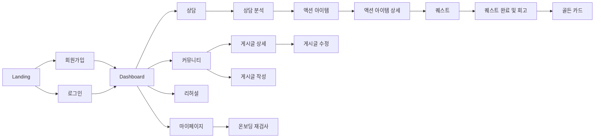

## 6. 현재 구현 상태 참고

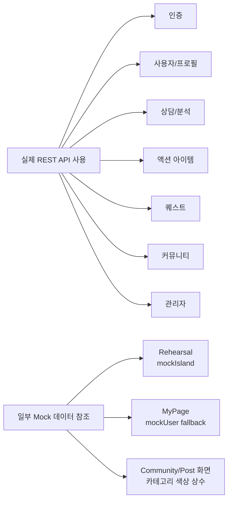

# Backend

백엔드는 Java 21, Spring Boot 3.2.5, Spring Data JPA, Spring Security와 MySQL을 사용합니다.

## 7. 백엔드 프로젝트 구조

```mermaid
flowchart TB
    ROOT["backend/"]

    ROOT --> BUILD["Gradle 설정<br/>build.gradle · settings.gradle"]
    ROOT --> DB["db/schema.sql"]
    ROOT --> RESOURCES["src/main/resources/"]
    ROOT --> JAVA["src/main/java/com/reroute/"]

    RESOURCES --> APP_YML["application.yml<br/>서버 · JWT · LLM · Swagger"]
    RESOURCES --> LOCAL_YML["application-local.yml<br/>MySQL · JPA"]

    JAVA --> ENTRY["RerouteApplication.java"]
    JAVA --> GLOBAL["global/"]
    JAVA --> DOMAIN["domain/"]

    GLOBAL --> CONFIG["config/<br/>Security · CORS · OpenAPI"]
    GLOBAL --> SECURITY["security/<br/>JwtAuthFilter · JwtUtil"]
    GLOBAL --> EXCEPTION["exception/<br/>전역 예외 처리"]
    GLOBAL --> RESPONSE["response/<br/>ApiResponse"]
    GLOBAL --> HEALTH["controller/<br/>HealthController"]

    DOMAIN --> AUTH["auth/<br/>인증 · 토큰 · 이메일 인증"]
    DOMAIN --> USER["user/<br/>회원 · 온보딩 · 통계"]
    DOMAIN --> COUNSELING["counseling/<br/>상담 · 메시지 · 분석"]
    DOMAIN --> ACTION["actionitem/<br/>액션 아이템"]
    DOMAIN --> QUEST["quest/<br/>퀘스트 · 회고"]
    DOMAIN --> COMMUNITY["community/<br/>게시글 · 댓글 · 캠프파이어 · 검열"]
    DOMAIN --> LLM["llm/<br/>Gemini · OpenAI 추상화"]
    DOMAIN --> ADMIN["admin/<br/>관리자 기능"]
    DOMAIN --> SCENARIO["scenario/<br/>리허설 시나리오"]
    DOMAIN --> REHEARSAL["rehearsal/<br/>리허설"]
    DOMAIN --> REPORT["report/<br/>신고"]
    DOMAIN --> NOTIFICATION["notification/<br/>알림"]
    DOMAIN --> COMMON["common/<br/>RecoveryType"]
```

## 8. 백엔드 계층 구조

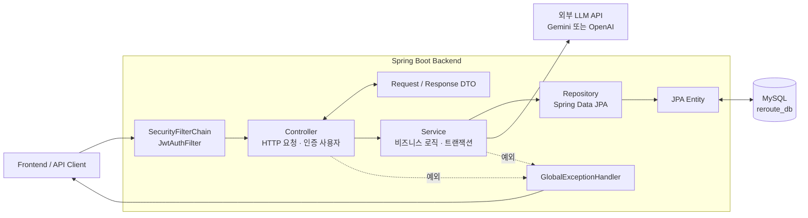

## 9. 도메인 의존 관계

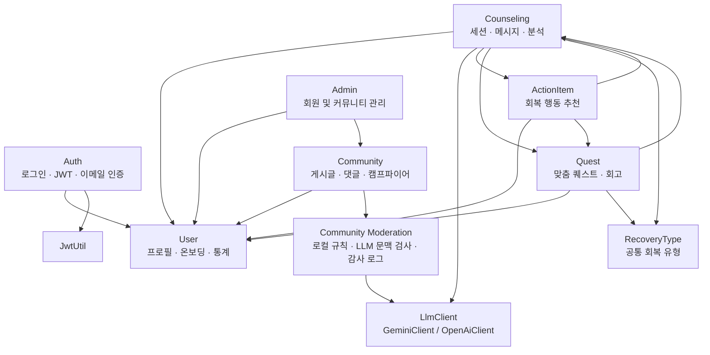

## 10. 인증 요청 처리 흐름

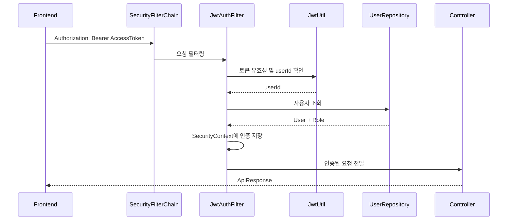

공개 API는 회원가입, 로그인, 토큰 갱신, 이메일 인증, 헬스 체크와 Swagger입니다. `/api/admin/**`는 `ADMIN` 역할이 필요하며, 나머지 API는 인증된 사용자만 접근할 수 있습니다.

## 11. 상담 분석 및 추천 생성 흐름

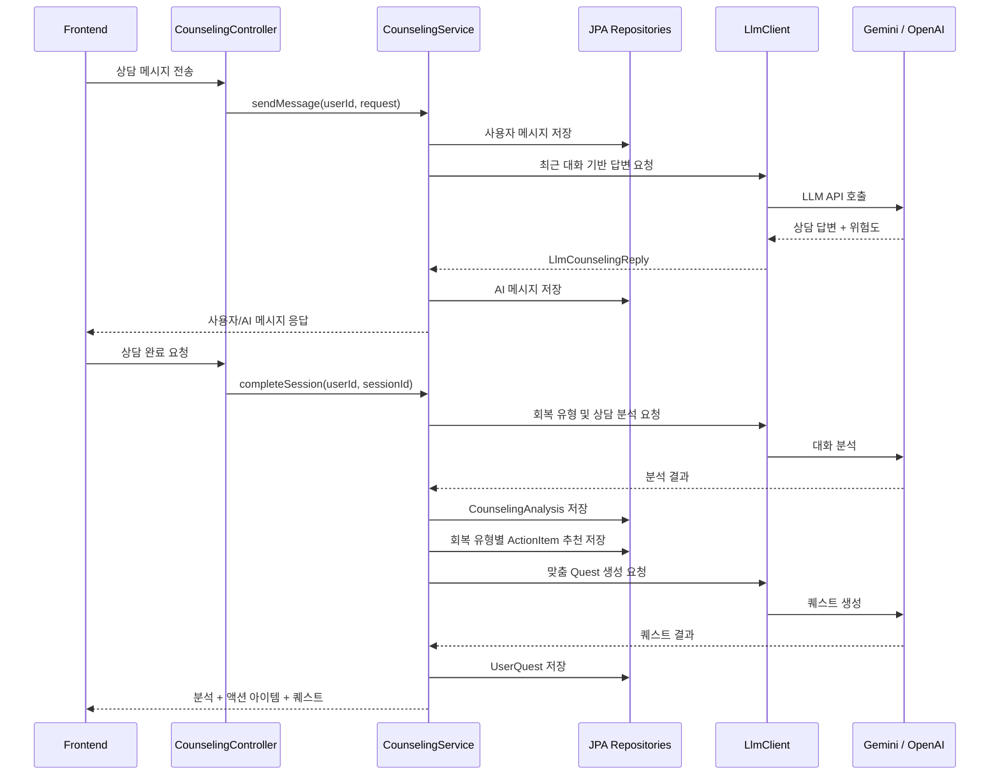

## 12. 주요 엔티티 관계

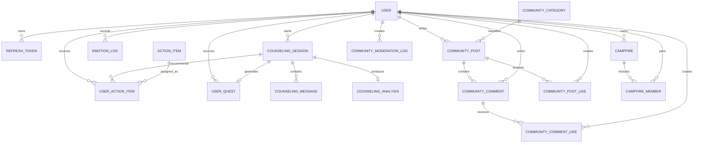

## 13. 백엔드 API 영역

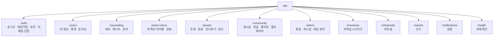

## 14. 현재 백엔드 구현 상태

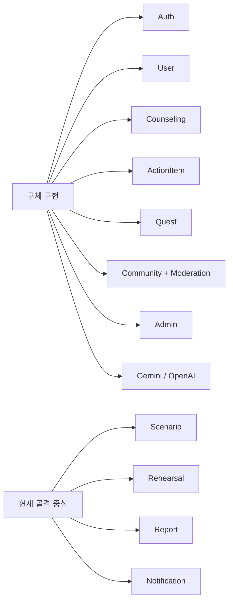

# Database

DBMS는 MySQL이며 기본 데이터베이스 이름은 `reroute_db`입니다. 문자셋은 `utf8mb4`, 정렬 규칙은 `utf8mb4_unicode_ci`를 사용합니다.

현재 `application-local.yml`의 `spring.jpa.hibernate.ddl-auto`가 `update`이므로 실제 로컬 DB는 `db/schema.sql`의 테이블에 JPA 엔티티 변경사항이 추가된 형태일 수 있습니다.

## 15. DB 도메인 구성

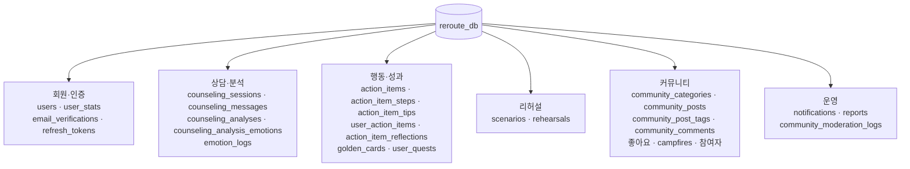

`user_quests`와 `community_moderation_logs`는 현재 JPA 엔티티에는 존재하지만 `db/schema.sql`에는 정의되어 있지 않습니다. `ddl-auto: update` 실행 시 Hibernate가 생성할 수 있습니다.

## 16. 회원·상담 DB 구조

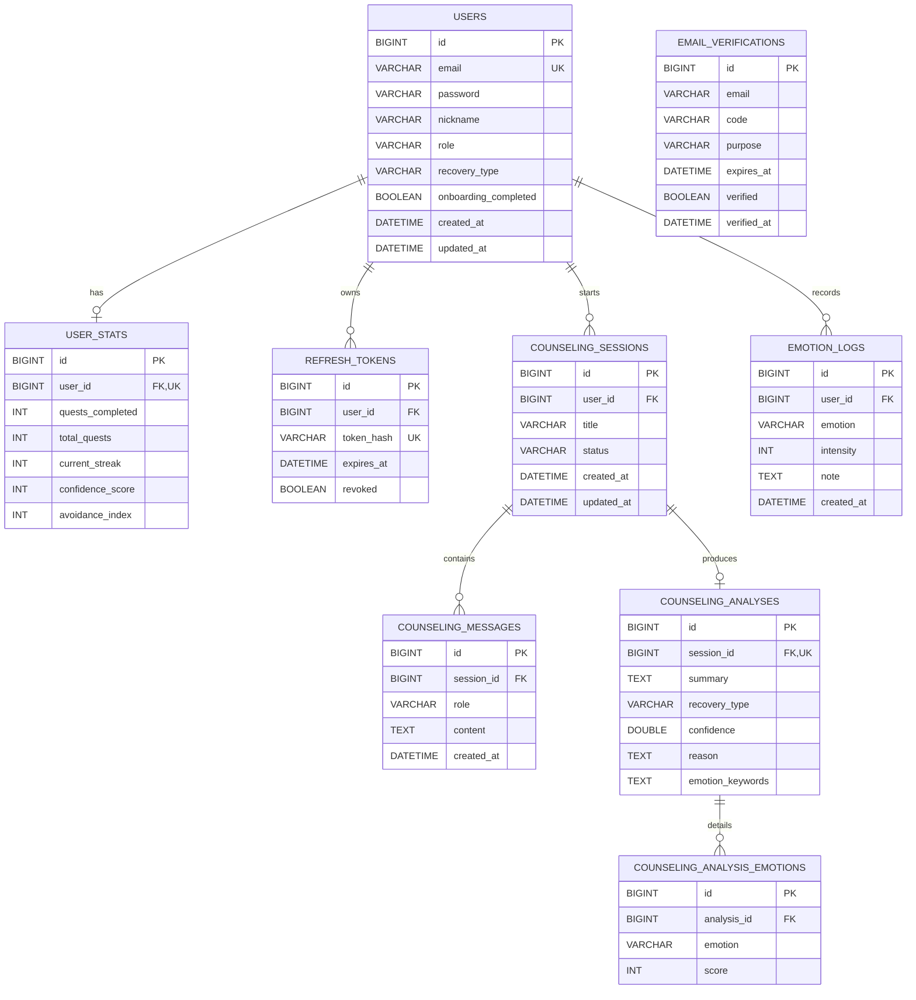

`email_verifications`는 가입 전 이메일도 저장해야 하므로 `users`와 외래 키로 연결하지 않고 이메일 문자열을 기준으로 관리합니다.

## 17. 액션 아이템·퀘스트·리허설 DB 구조

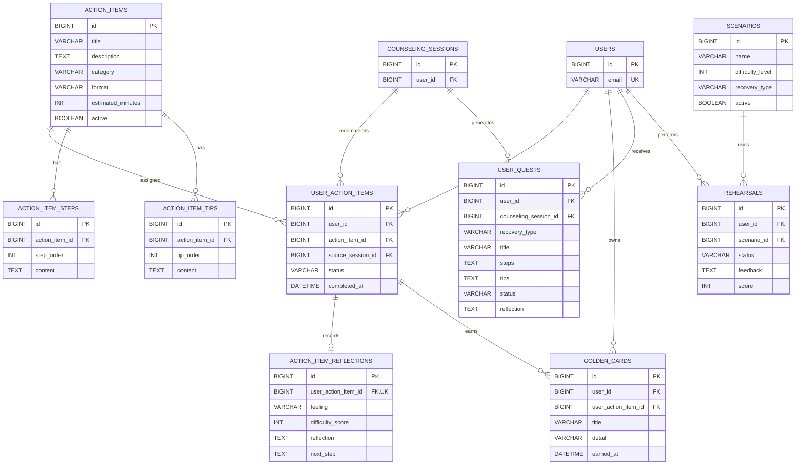

`USER_QUESTS`는 현재 `UserQuest` JPA 엔티티 기준입니다. `ACTION_ITEM_STEPS`, `ACTION_ITEM_TIPS`, `ACTION_ITEM_REFLECTIONS`, `GOLDEN_CARDS`, `SCENARIOS`, `REHEARSALS`는 `schema.sql`에 정의되어 있으나 대응하는 완성된 JPA 엔티티 또는 기능은 아직 없습니다.

## 18. 커뮤니티 DB 구조

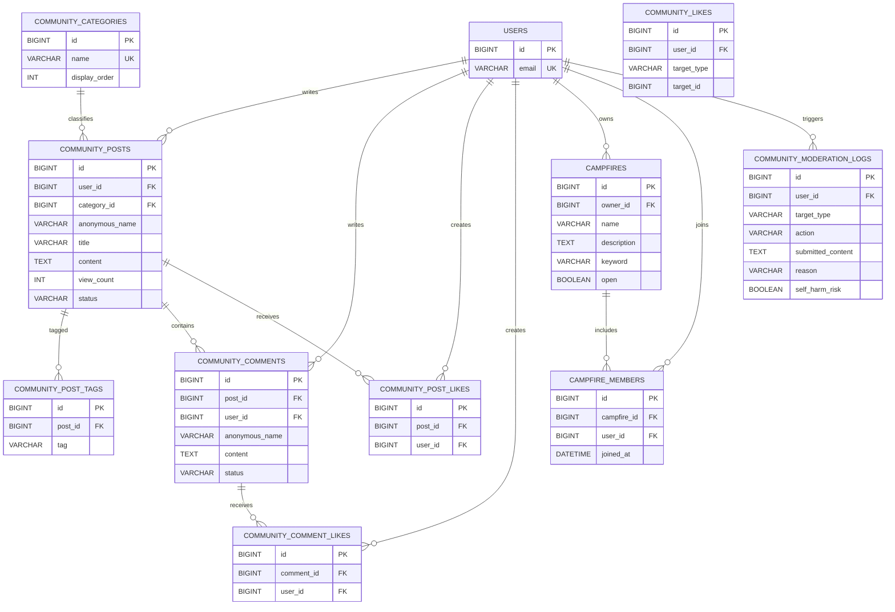

`schema.sql`은 좋아요를 `community_likes` 단일 다형 테이블로 정의하지만, 현재 JPA 엔티티는 `community_post_likes`와 `community_comment_likes`로 분리합니다. 캠프파이어 참여 테이블도 `schema.sql`의 `campfire_participants`와 JPA의 `campfire_members`가 서로 다릅니다.

## 19. 알림·신고 DB 구조

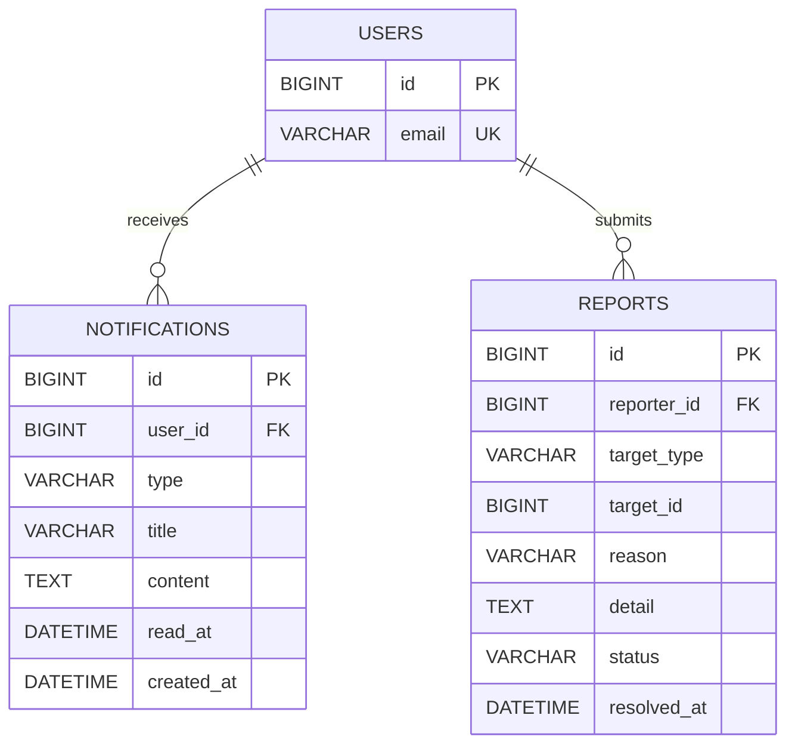

`reports.target_id`는 게시글이나 댓글 등 여러 종류의 대상을 가리키는 다형 참조이므로 특정 테이블에 대한 물리 외래 키는 없습니다.

## 20. 스키마와 JPA 엔티티 차이

| 영역 | `db/schema.sql` | 현재 JPA 엔티티 |
|---|---|---|
| 사용자 회복 유형 | `users.recovery_type` | `users.primary_recovery_type` |
| 사용자 퀘스트 | 테이블 정의 없음 | `user_quests` 엔티티 존재 |
| 사용자 액션 출처 | `source_session_id` | `counseling_session_id` |
| 게시글 작성자 | `user_id` | `user_id`와 `author_id`를 함께 매핑 |
| 게시글 카테고리/태그 | 정규화 테이블 사용 | 문자열 및 JSON 컬럼도 함께 사용 |
| 댓글 작성자 | `user_id` | `author_id` |
| 커뮤니티 좋아요 | `community_likes` 단일 테이블 | 게시글/댓글 좋아요 테이블 분리 |
| 캠프파이어 소유자 | 소유자 컬럼 없음 | `owner_id` 필수 |
| 캠프파이어 참여 | `campfire_participants` | `campfire_members` |
| 커뮤니티 검열 로그 | 테이블 정의 없음 | `community_moderation_logs` 엔티티 존재 |

현재 개발 환경에서는 Hibernate가 스키마를 자동 보정하지만, 운영 환경에서는 `schema.sql`과 엔티티 중 하나를 기준으로 확정하고 Flyway 또는 Liquibase 마이그레이션으로 관리하는 편이 안전합니다.
